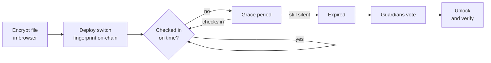

# Heartbeat

**A dead man's switch on Ethereum, guarded by people you trust.**

Lock a file behind a timer *and* a group of guardians. Check in to prove you're
okay. Stop checking in, and your guardians vote to release it. A fingerprint on
the blockchain proves the file they recover is your untouched original.

> **How this was built.** The Solidity contract (`contracts/src/Heartbeat.sol`)
> and its Foundry tests (`contracts/test/Heartbeat.t.sol`) are hand-written, no
> AI. The frontend in `frontend/` was built with
> [Claude Code](https://claude.com/claude-code).

## Demo

https://github.com/user-attachments/assets/ebe6356a-7f45-4d02-820c-1c5ac5a75e14

---

## Why

**WikiLeaks, 2010.** They posted a 1.4 GB encrypted file named `insurance.aes256`,
to be unlocked if something happened to them ([The Register][reg],
[Schneier on Security][schneier]). Two problems nobody could solve:

- Nobody could prove it was real — [its contents, and even whether it was really
  AES-256 at all, were never verified][schneier].
- Nobody could prove it hadn't been swapped for a doctored copy.

Heartbeat writes the file's [SHA-256][sha] fingerprint to the blockchain the
moment the switch is created. When guardians unlock it, the app recomputes that hash and
compares. One byte different and verification fails.

**Other dead man's switches trust a timer.** A missed check-in might mean you're
dead — or in hospital, or travelling, or you forgot. A timer can't tell. People
who know you can. Heartbeat needs both: the timer runs out **and** your guardians
agree.

---

## How it works



**Nothing secret leaves the browser.** The server never sees your file, your key,
or the shares. On-chain there is only a fingerprint and an IPFS address.

### The four states

| State | Meaning |
|---|---|
| **Alive** | You're within the check-in window |
| **Grace period** | You missed one — a warning, you can still check in |
| **Expired** | Owner locked out permanently. Guardians may vote |
| **Released** | Enough guardians voted. The file can be unlocked |

Expiry is pure arithmetic — nobody has to trigger it:
`block.timestamp > lastCheckIn + interval + gracePeriod`

(Validators can nudge [`block.timestamp`][timestamp] by a few seconds. Irrelevant
at minutes-to-days scales.)

### Why the key is split

If one guardian held the whole key, they could read your file whenever they
liked. Instead it's split with [**Shamir's Secret Sharing**][shamir-paper]
(Shamir, 1979): any 2 of 3 shares rebuild it exactly, and 1 share reveals
**nothing** — not half the key, not a hint. Implementation:
[`shamir-secret-sharing`][shamir-lib], audited, zero dependencies.

---

## Security

**The chain proves:** the timer really ran out, enough guardians really voted,
and the fingerprint existed before the file was released. Anyone can verify this
without trusting us.

**The crypto protects:** the file. [AES-256-GCM][gcm] is authenticated, so a
wrong key or a tampered file fails loudly instead of returning plausible garbage.
All of it runs in the browser's built-in [Web Crypto API][webcrypto] — no
hand-rolled cryptography, no third-party crypto library.

### Current obstacles

Some of these are fixable, others are inherent to the design. Either way,
better said plainly than discovered by a user.

- **Guardians hold shares from day one.** Enough of them could collude early.
  `released()` coordinates honest people; it doesn't restrain dishonest ones.
  Same trust model as a multisig wallet.
- **Whoever combines the shares sees the file.** 2-of-3 stops one guardian acting
  alone, not two deciding one does the work.
- **Guardian addresses are public forever.** Use fresh wallets.
- **IPFS needs someone pinning.** We use [Pinata][pinata]; guardians should keep
  their own copy. [CIDs are content-addressed][cid], so any node with the same
  bytes satisfies the link already on-chain.
- **A half-configured switch bricks.** Every owner function is `notExpired`, and
  releasing needs `votesNeeded > 0`. A switch that expires with no guardians can
  never be used again by anyone. The UI warns; moving guardians into the
  constructor would make it impossible.

---

## Cost

Measured on the real contract:

| Action | Gas | How often |
|---|---|---|
| Deploy a switch | 1,786,622 | once |
| Add a guardian | 121,846 | per guardian |
| Set vote threshold | 51,932 | once |
| **Check in** | **27,308** | every time |

The expensive part happens once. Staying alive costs ~27k gas — pennies on
mainnet, nothing on an L2.

---

## Run it

Needs [Nix](https://nixos.org), which provides `forge`, `anvil`, `cast`, `node`.

```bash
nix develop          # repo root
```

```bash
anvil                # terminal 1: local chain
```

```bash
cd contracts         # terminal 2
forge test           # 34 tests
```

```bash
cd frontend          # terminal 3
npm install
npm test             # 52 tests
npm run dev          # localhost:3000
```

Point a browser wallet at Anvil (RPC `http://127.0.0.1:8545`, chain id `31337`).
The landing page has a **Get test ETH** button — Anvil's ETH is fake and printed
on demand.

### Config

Copy `frontend/.env.local.example` to `frontend/.env.local`:

| Variable | For |
|---|---|
| `NEXT_PUBLIC_WALLETCONNECT_PROJECT_ID` | RainbowKit (only needed for phone wallets) |
| `PINATA_JWT` | real IPFS uploads. **Server-side only** |
| `NEXT_PUBLIC_IPFS_GATEWAY` | optional, faster reads |

Without `PINATA_JWT` everything still works — encrypted files go to the browser's
localStorage under a fake `local-…` CID, so you can demo offline.

### Skipping ahead in time

```bash
cast rpc evm_increaseTime 600 --rpc-url http://127.0.0.1:8545
cast rpc evm_mine --rpc-url http://127.0.0.1:8545
```

Anvil forgets everything on restart. Redeploy, re-fund, and clear your wallet's
activity data if transactions start failing.

---

## Tests

**34 Foundry tests** on the contract, **65 vitest tests** on the frontend —
covering the state machine, fingerprinting, AES round-trips, tamper and wrong-key
rejection, Shamir thresholds, gateway handling, and the full owner → guardian
pipeline including *"a substituted file fails verification."*

```bash
cd contracts && forge test
cd frontend  && npm test
```

### Contract coverage

`forge coverage` on `src/Heartbeat.sol`:

| | Coverage |
|---|---|
| Lines | **100%** (61/61) |
| Statements | **100%** (55/55) |
| Branches | **93.55%** (29/31) |
| Functions | **100%** (13/13) |

Every line, statement and function of the contract is exercised. The two
uncovered branches are `require` guards on inputs the tests cannot produce
through the public interface. The deploy script is deliberately untested, which
is why a whole-project total would read lower.

---

## Layout

```
contracts/
  src/Heartbeat.sol         the contract — 202 lines, hand-written
  test/Heartbeat.t.sol      34 tests
frontend/
  app/
    page.tsx                landing
    setup/                  create a switch
    switch/[address]/       one switch's dashboard
    api/upload/             Pinata upload (server-side)
  components/               panels, tabs, UI
  lib/
    crypto.ts               fingerprint + AES-256-GCM (Web Crypto)
    shamir.ts               key splitting
    heartbeatState.ts       alive / grace / expired / released
    useHeartbeat.ts         contract reads and writes
    __tests__/              52 tests
```

The ABI is generated from the Foundry build, never hand-written.

---

## Future improvements

**Make a broken switch impossible.** Guardians and the vote threshold are set in
separate transactions after deployment, so a switch can briefly exist
half-configured — and if it expires that way it is bricked forever. Moving both
into the constructor would make that state unrepresentable, cost one wallet
prompt instead of five, and save ~84k gas.

**Timelock encryption.** Guardians currently hold their shares from day one, so
enough of them could collude early. Schemes like
[drand's timelock](https://drand.love/docs/timelock-encryption/) release a
decryption key at a chosen time instead, removing the need to trust anyone with
a share in advance. Combining both would mean guardians *and* a clock.

**Duress check-in.** A second passphrase that looks like a normal check-in but
quietly starts the release countdown — for when someone is forced to check in
while under coercion.

**Guardian rotation.** Guardians can be added and removed on-chain, but their
key shares are fixed at creation. Re-splitting the key when the guardian set
changes would keep the two in step.

**Cheaper chains.** Deploying costs 1.79M gas, a few dollars on mainnet. On an
L2 that is cents, which matters for something ordinary people are meant to use.

**Inheritance, not just disclosure.** The contract could hold ETH or tokens and
release them to named beneficiaries on the same trigger, making it a dead man's
switch for assets as well as secrets.

**Smaller things:** zip folders before encrypting, one invite link per guardian
instead of copying addresses by hand, and reminders before a check-in is due.

---

## Sources

**The event**
- [WikiLeaks publishes encrypted 'insurance' file][reg] — The Register, Aug 2010
- [WikiLeaks Insurance File][schneier] — Bruce Schneier, Aug 2010

**Cryptography**
- [Shamir, "How to Share a Secret"][shamir-paper] — CACM 22(11), 1979
- [`shamir-secret-sharing`][shamir-lib] — the implementation used here
- [NIST SP 800-38D][gcm] — AES-GCM
- [FIPS 180-4][sha] — SHA-256
- [Web Crypto `SubtleCrypto`][webcrypto] — MDN

**Platform**
- [Solidity][sol] · [Foundry][foundry] · [`block.timestamp`][timestamp]
- [Next.js][next] · [RainbowKit][rainbow] · [wagmi][wagmi] · [viem][viem]
- [IPFS content addressing][cid] · [Pinata upload API][pinata]

[reg]: https://www.theregister.com/2010/08/02/wikileaks_insurance/
[schneier]: https://www.schneier.com/blog/archives/2010/08/wikileaks_insur.html
[shamir-paper]: https://doi.org/10.1145/359168.359176
[shamir-lib]: https://github.com/privy-io/shamir-secret-sharing
[gcm]: https://nvlpubs.nist.gov/nistpubs/Legacy/SP/nistspecialpublication800-38d.pdf
[sha]: https://nvlpubs.nist.gov/nistpubs/FIPS/NIST.FIPS.180-4.pdf
[webcrypto]: https://developer.mozilla.org/en-US/docs/Web/API/SubtleCrypto
[sol]: https://docs.soliditylang.org/en/latest/
[foundry]: https://getfoundry.sh/
[timestamp]: https://docs.soliditylang.org/en/latest/units-and-global-variables.html#block-and-transaction-properties
[next]: https://nextjs.org/docs
[rainbow]: https://rainbowkit.com/docs/installation
[wagmi]: https://wagmi.sh/react/getting-started
[viem]: https://viem.sh/docs/getting-started
[cid]: https://docs.ipfs.tech/concepts/content-addressing/
[pinata]: https://docs.pinata.cloud/api-reference/endpoint/upload-a-file

## Built with

[Solidity][sol] · [Foundry][foundry] · [Next.js][next] · [RainbowKit][rainbow] ·
[wagmi][wagmi] · [viem][viem] · [Web Crypto][webcrypto] · [Shamir Secret
Sharing][shamir-lib] · [IPFS][cid]
